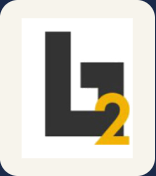

# ByCS-Kursbanner (B2 Nürnberg)

Erzeugt ein PNG-Kursbild für ByCS (Moodle) im einheitlichen Schul-Look. Alle Banner sollen gleich aussehen, nur Text und Bild wechseln.

## Schritt 1 – Angaben klären (nur was fehlt)
- **Titel** (groß, Versalien), z. B. `METALL`, `ETHIK`
- **Stufe/Klasse** (Zeile 2, Versalien, gesperrt), z. B. `GRUNDSTUFE`, `10. KLASSE`
- **Untertitel** (klein), z. B. `Fachunterricht`, `Was ist gut? Was ist richtig?`
- **Bild** (optional): Foto oder Grafik für die rechte Seite. Ohne Bild bleibt die rechte Hälfte einfarbig oder bekommt eine schlichte SVG-Illustration im Stil (flache Formen, Farben unten).
- **B2-Logo**: liegt als `b2-logo.png` im Ordner dieses Skills (neben dieser SKILL.md). In den Arbeitsordner kopieren. BYCS selbst kommt nicht ins Banner.

## Festes Design
- Format: **1600 x 900 px**, PNG, Dateiname `<Titel>-Banner-ByCS.png`
- Hintergrund: Navy `#1B2A4A`
- Textfarbe: Creme `#F7F4EC`, Untertitel `#C3C9D8`
- Akzent: Orange `#F2A33A` (Strich unter dem Titel), weitere Akzente Petrol `#2AA39F`, Braun `#6B5644`. Navy, Creme und Orange sind dieselben Werte wie in der Vorlage `Allgemeinbildung.html` und in den Abschnittstexten des Skills Baue-Kurs.
- Schrift: Poppins/DM Sans, falls installiert, sonst **Inter** (Titel: Inter Display Black). Fehlt auch Inter: Segoe UI (Titel: Segoe UI Black).
- Textblock links (x = 100 px), vertikal mittig: Titel ca. 168 px (bei langen Wörtern verkleinern, damit er höchstens ca. 700 px breit ist), orangener Strich 96 x 7 px, Stufe 50 px mit letter-spacing 9 px, Untertitel 27 px
- Foto rechts: volle Höhe, ca. 950 px breit, `object-fit: cover`, nach links weich in Navy ausgeblendet (Gradient), unten leicht abgedunkelt
- **B2-Logo: rechts, vertikal mittig** (right 72 px, Breite 156 px, abgerundete Ecken)
- Wichtige Inhalte in der Mitte halten; ByCS kann Ränder beschneiden.

## Schritt 2 – Bauen, Prüfen und Abschluss
1. Eingaben klären und Bild sowie Logo in einen Arbeitsordner im Scratchpad kopieren (nicht ins Repo).
2. `banner.html` nach der Vorlage unten schreiben und die Platzhalter ersetzen.
3. Rendern (Viewport 1600x900) mit dem installierten Edge oder Chrome, ohne Node und ohne weitere Installation: `--headless=new --force-device-scale-factor=1 --window-size=1600,900 --screenshot=<png> <banner.html>`, mit eigenem `--user-data-dir` im Arbeitsordner; bei leerem Ergebnis einmal wiederholen. Pfade zum Browser wie in `.claude/gemeinsam/scripts/seite-pruefen.py`.
4. Ergebnis-PNG ansehen und prüfen: Text vollständig lesbar, Titel nicht zu nah am Foto, Logo-Ecken sauber (keine fremden Hintergrundreste), nichts abgeschnitten. Bei Bedarf anpassen und neu rendern.
5. PNG nach `Ressourcen/Bilder/<Thema>/<Titel>-Banner-ByCS.png` legen, in `Ressourcen/Inhalt.md` eintragen (`.claude/gemeinsam/regeln/ablage.md`, Ressourcen) und kurz sagen, wo es liegt. Im Kursplan steht dieser Pfad unter `kurs.banner` (Skill Baue-Kurs).

## HTML-Vorlage
```html
<html><body style="margin:0">
<div style="position:relative;width:1600px;height:900px;background:#1B2A4A;overflow:hidden;font-family:Inter">
  <!-- Bild rechts (weglassen, wenn kein Bild) -->
  
  <div style="position:absolute;inset:0;background:linear-gradient(90deg,#1B2A4A 0%,#1B2A4A 42%,rgba(27,42,74,.85) 52%,rgba(27,42,74,0) 72%)"></div>
  <div style="position:absolute;inset:0;background:linear-gradient(0deg,rgba(27,42,74,.55),rgba(27,42,74,0) 30%)"></div>
  <!-- Text -->
  <div style="position:absolute;left:100px;top:272px;color:#F7F4EC">
    <div style="font-family:'Inter Display';font-weight:900;font-size:168px;letter-spacing:4px;line-height:1">{{TITEL}}</div>
    <div style="width:96px;height:7px;border-radius:4px;background:#F2A33A;margin:52px 0 30px"></div>
    <div style="font-weight:500;font-size:50px;letter-spacing:9px">{{STUFE}}</div>
    <div style="font-size:27px;color:#C3C9D8;margin-top:26px;letter-spacing:1px">{{UNTERTITEL}}</div>
  </div>
  <!-- B2-Logo rechts, vertikal mittig -->
  
</div></body></html>
```

## Hinweise
- Hat ein Foto viel helle Fläche hinter dem Logo, ist das in Ordnung: Das Logo hat ein eigenes helles Feld.
- Für eine Reihe von Kursen dieselben Maße und Positionen beibehalten, damit die Kursübersicht einheitlich wirkt.
- Wenn ein vorhandenes, zu flaches Banner nur höher werden soll: auf 1600x900 Navy-Fläche mittig einsetzen (Hintergrundfarbe vorher aus einem Eckpixel lesen).
